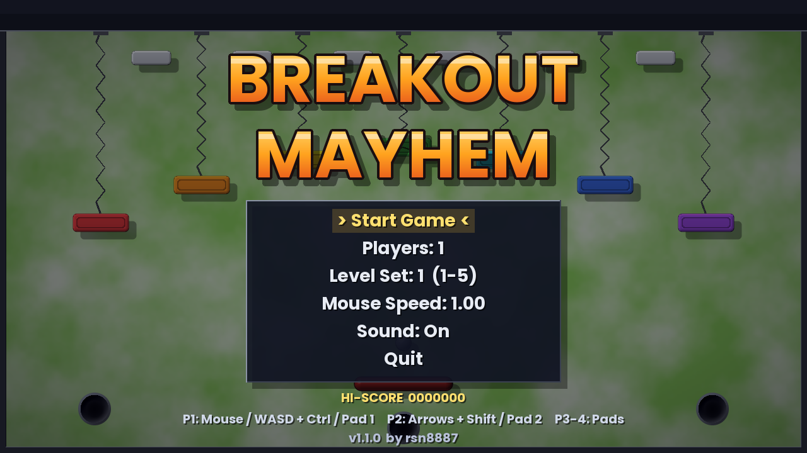
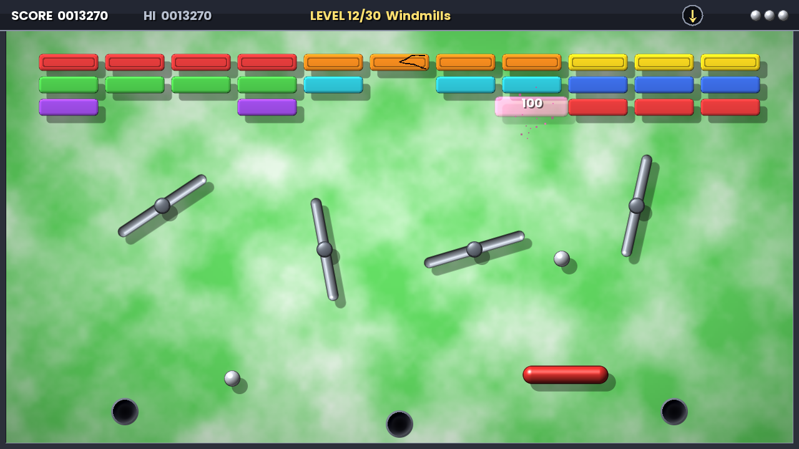

# Breakout Mayhem

A physics-driven bat-and-ball skill game in the spirit of **Breakout** and **Arkanoid**, with the
free-roaming bat and hole-riddled playfields of **Bolo** (Dongleware). It's written in C++17 with SDL2 and SDL2_ttf.

It uses hand-coded, force-based physics:

- the bat moves freely in 2D and is driven by forces, so it has **inertia and friction**;
- the ball has **gravity** and (in)elastic collisions with everything;
- the moving bat **rubs** the ball, so swiping the bat as you hit steers and spins the ball;
- balls are lost only by falling into **suction holes**, never by leaving the screen.





## Features

- 1280×720, 30 levels in six level sets of five, each level built around a different physics idea
- capsule bat with rounded ends: hits near an end deflect the ball, Arkanoid-style
- up to 4 simultaneous players (mouse, keyboard, gamepads, Switch touch screen)
- runs on Linux, macOS, Windows and Nintendo Switch
- power-ups that are physical objects (they fall, drift, bounce and can be sucked into holes)
- combo multiplier: every brick broken without touching a bat raises the multiplier (up to x8)
- procedurally generated, shaded, anti-aliased 90s-style graphics (no image files)
- synthesized sound effects (no sample files), attract mode, high score and progress saving

## Controls

| | |
|---|---|
| Player 1 | mouse (bat follows the mouse movement), or W A S D (+ Left Ctrl turbo), or gamepad 1 |
| Player 2 | arrow keys (+ Right Shift turbo), or gamepad 2 (in a 1-player game the arrows also move player 1) |
| Players 3–4 | gamepads 3 and 4 |
| Gamepad | left stick / D-pad move, any face button or trigger = turbo, Start/+ = pause |
| Switch | as gamepad; touch screen: drag to move the bat, tap to continue |
| Esc / P | pause menu |
| F, F11, Alt+Enter | toggle fullscreen |
| K / L | mouse sensitivity down / up |
| M | sound on / off |

In the title menu, choose the number of players and a level set: one of the six sets of five levels, or "Complete" to play all 30 levels in a row.

## Building

Always build out of the source tree. The commands below assume you're in the folder that *contains*
`BreakoutMayhem/`, so build folders end up next to the project, not inside it.

### Linux

```sh
sudo apt install cmake g++ libsdl2-dev libsdl2-ttf-dev
cmake -S BreakoutMayhem -B build
cmake --build build -j
./build/BreakoutMayhem
```

### macOS (Homebrew)

```sh
brew install cmake sdl2 sdl2_ttf
cmake -S BreakoutMayhem -B build
cmake --build build -j
./build/BreakoutMayhem
```

App bundle and drag-to-Applications DMG (also bundles the SDL dylibs; needs `brew install dylibbundler`):

```sh
./BreakoutMayhem/tools/make_dmg.sh        # -> build-mac/BreakoutMayhem-1.1.0.dmg
```

### Windows (MSYS2 UCRT64)

```sh
pacman -S mingw-w64-ucrt-x86_64-{gcc,cmake,ninja,SDL2,SDL2_ttf}
cmake -S BreakoutMayhem -B build -G Ninja
cmake --build build
```

### Nintendo Switch (devkitPro)

With the `devkitpro/devkita64` Docker image (it has the switch-sdl2 / switch-sdl2_ttf portlibs):

```sh
docker run --rm -v "$PWD":/work -w /work devkitpro/devkita64 \
    sh -c "cmake -S BreakoutMayhem -B build-switch -DPLATFORM=SWITCH && cmake --build build-switch -j"
```

Copy `build-switch/BreakoutMayhem.nro` to `/switch/` on the SD card. Settings and the high score are stored in
`/switch/BreakoutMayhem/settings.txt`.

## Source layout

| File | Contents |
|------|----------|
| `src/physics.*` | bodies, shapes (circle, box, capsule), forces, fields, collisions |
| `src/levels.*` | level layouts |
| `src/game.*` | game states, scoring, power-ups, particles, demo/test AI |
| `src/render.*` | procedural sprite generation and all drawing |
| `src/audio.*` | tiny synthesizer for the sound effects |
| `src/main.cpp` | SDL setup, input, main loop, platform specifics |

## Credits

Game, code and physics: rsn8887, assisted by Claude.

Font: Poppins Bold, © The Poppins Project Authors, SIL Open Font License 1.1 (see `data/Poppins-OFL.txt`).
